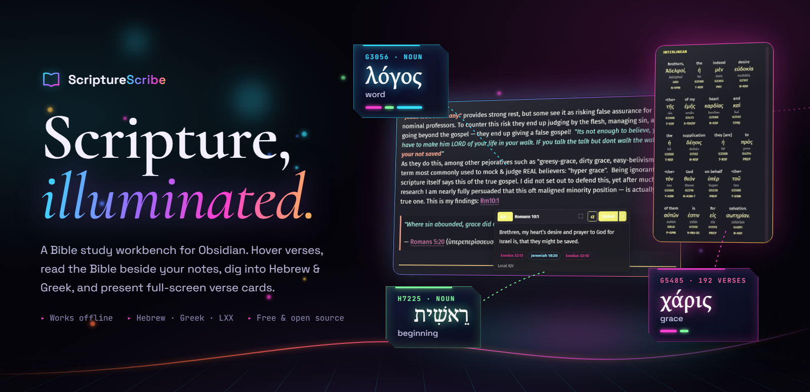
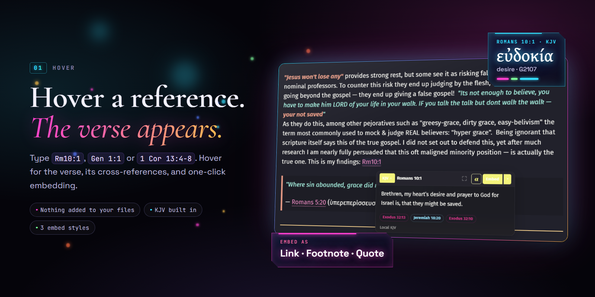
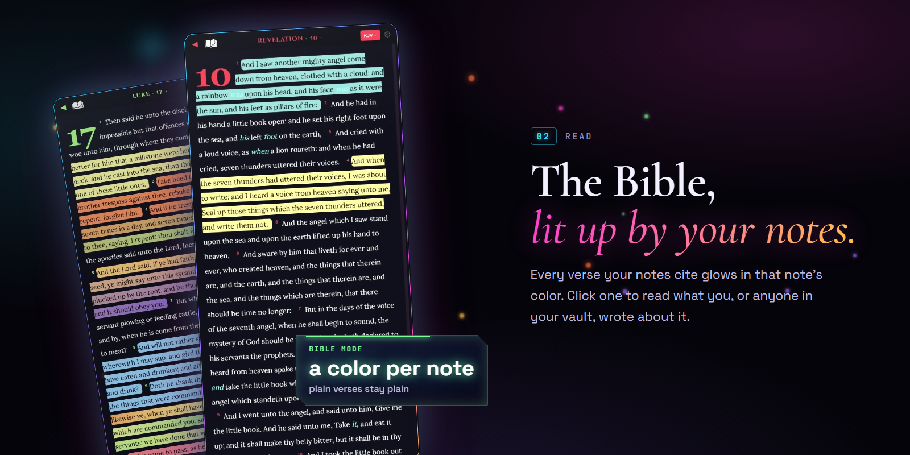
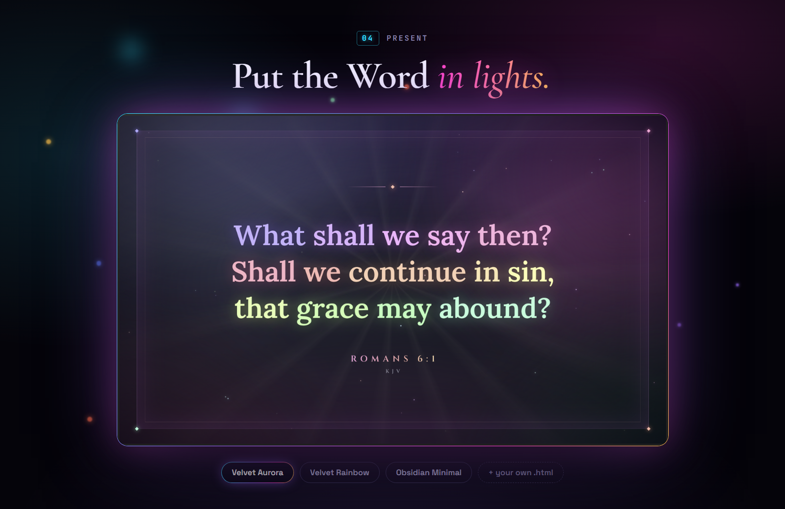

<p align="center">
  <a href="https://joyraptor.github.io/ScriptureScribe/"></a>
</p>

<p align="center">
  <a href="https://github.com/JoyRaptor/ScriptureScribe/releases/latest"></a>
  <a href="https://obsidian.md"></a>
  
  <a href="https://github.com/JoyRaptor/ScriptureScribe/releases"></a>
</p>

<p align="center">
  <b>Hover any verse</b> · <b>Read the Bible beside your notes</b> · <b>Hebrew &amp; Greek, word by word</b> · <b>Full-screen verse cards</b>
</p>

<p align="center">
  <a href="https://github.com/JoyRaptor/ScriptureScribe/releases/latest/download/scripture-scribe.zip"></a>
</p>

<p align="center">
  <b>Or get the full study vault</b>: ScriptureScribe and the Orchard Tree already installed, with the real studies, as seen on <a href="https://www.youtube.com/playlist?list=PLgxNk3D5DVOfHKKx-UaiHH4urLASes8Lu">JoyRaptor's Bible studies</a>.<br>
  <a href="https://github.com/JoyRaptor/ScriptureScribe/releases/latest/download/ScriptureScribe-demo-vault.zip"><b>⬇ Download the study vault (84 MB)</b></a>
</p>

<p align="center">
  <a href="https://joyraptor.github.io/ScriptureScribe/"><b>Website</b></a> &nbsp;·&nbsp;
  <a href="#-install-in-2-minutes"><b>Install in 2 minutes</b></a> &nbsp;·&nbsp;
  <a href="https://github.com/JoyRaptor/ScriptureScribe/releases"><b>Releases</b></a>
</p>

<br>

## ✦ A second brain for your Bible

Bible software like Logos and e-Sword was built around a library, with a notes pane added on. ScriptureScribe starts from **your notes**: everything you write becomes part of how you read Scripture.

| | Traditional Bible software | ScriptureScribe |
|---|---|---|
| **Your notes** | Live inside the app's own database | Plain Markdown files you own, in Obsidian |
| **Connecting a note to a verse** | Attach it by hand | Just write `Rom 6:1`. It's connected, and so is `v4` on the next line |
| **Reading the Bible** | A note icon here and there | Every verse your notes cite lights up in that note's color. Click it to read what was written |
| **Other people's insight** | Buy or install commentary modules | Drop a friend's, pastor's or teacher's notes into your vault. Their writing appears on every verse they cite |
| **Writing** | Copy, paste, format | Hover to check, one click to embed, *Embed All* for the whole note |
| **Hebrew & Greek** | Often a separate purchase | Interlinear, Strong's, LSJ and the Septuagint included, offline |
| **Teaching & video** | Export to presentation software | Card Mode: hover a verse in your notes and it fills the screen |

<p align="center"></p>

- Spots references as you type: `Gen 1:1`, `Jn 3:16`, `1 Cor 13:4-8`, `2Tim 3:16`, `Ps 119:105`, `Rm10:1`
- **Nothing is added to your markdown.** References are underlined on screen, and your files stay untouched.
- Hover for the verse, switch translation, and jump to cross-references
- **Translations:** KJV and the Greek Septuagint are built in and work offline. WEB, ASV, Young's Literal (NT), Darby and Douay-Rheims load from [bible-api.com](https://bible-api.com) (public domain, needs internet). ESV, NIV, NASB, NKJV, NLT, CSB, NRSV, AMP, MSG and TLV are copyrighted, so the version menu opens them on BibleGateway instead of pretending to show them. If a translation can't load, you get the KJV, labelled as KJV.
- **Embed** a verse as a link, footnote or quote block, or use *Embed All* to convert the whole note in one undo step
- The KJV is built in, so it works with no internet

<p align="center"></p>

- Open **Bible mode** beside your writing. Every verse one of your notes cites is highlighted in that note's own color, and a verse cited by several notes blends them. Plain verses stay plain.
- Click a highlighted verse: **In your notes** lists every note that cites it, with the sentence around each citation, one click away. That includes notes other people wrote, if they're in your vault.
- References write naturally: `Acts 10:39` then `v40` on the next bullet, `Psalm 50` for a whole chapter (previews verse 1, never floods Bible mode), STEPBible codes like `Deu30:19`
- Verse numbers, drop caps, and the KJV's supplied words in *italics*, the way the translators marked them

<p align="center"></p>

- **Interlinear** Hebrew OT, Greek NT and Septuagint: original word, transliteration, Strong's number and morphology
- **Strong's search**: type `G5485` or `H7225` to get the lexicon entry and every verse that uses the word
- **Search** by English, Greek or Hebrew, or **by meaning** (the meaning model downloads once, about 23 MB, the first time you use it; until then concept search falls back to keyword scoring and says so)
- **Lexicons**: Strong's (19,570 entries), LSJ (10,714) and Swete's LXX
- **In your notes**: every note in your vault that cites the passage
- **Cross-references** for 28,752 verses

<p align="center"></p>

- **Card Mode** puts any verse on screen as a full-screen card, for preaching, teaching, streaming or recording
- Skins are plain HTML files: *Velvet Aurora*, *Velvet Rainbow* and *Obsidian Minimal* are included, or write your own
- Next and previous card, pin, emphasis and contrast are commands you can bind to hotkeys

<br>

## 🚀 Install in 2 minutes

> **No coding, no terminal.** The download already includes the Bible, Hebrew, Greek and lexicon data (77 MB zipped, about 210 MB installed).

> **Just want to look around?** Download the **[demo vault](https://github.com/JoyRaptor/ScriptureScribe/releases/latest/download/ScriptureScribe-demo-vault.zip)**: real study notes with ScriptureScribe already installed. Unzip it, choose *Open folder as vault* in Obsidian, click *Trust author and enable plugins*, and follow the 5-minute tour in "Start Here".

1. **[Download `scripture-scribe.zip`](https://github.com/JoyRaptor/ScriptureScribe/releases/latest/download/scripture-scribe.zip)**
2. **Unzip it.** You get one folder named `scripture-scribe`.
3. **Open your vault's plugins folder:** `<your vault>/.obsidian/plugins/`
   - `.obsidian` is hidden. To see it:
     - **Windows:** File Explorer → View → Show → *Hidden items*
     - **Mac:** in Finder press `Cmd + Shift + .`
   - Not sure where your vault is? In Obsidian, click the vault name at the bottom left and choose *Manage vaults*.
   - If there's no `plugins` folder, create one.
4. **Move the `scripture-scribe` folder into `plugins`.**
   You should end up with `.obsidian/plugins/scripture-scribe/main.js`.
5. In Obsidian open **Settings → Community plugins**, turn off **Restricted mode**, click the refresh icon, and switch **ScriptureScribe** on.
6. Type `John 3:16` in a note and hover it. 🎉

**Opening the panels:** press `Ctrl/Cmd + P` and run **ScriptureScribe: Open Reading Panel**, **Toggle Card Mode** or **Search Strong's number**.

<details>
<summary><b>Updating</b></summary>

Download the new zip and replace the `scripture-scribe` folder. Your settings are kept: they live in `data.json`, which the zip never includes.
</details>

<details>
<summary><b>Troubleshooting</b></summary>

| Problem | Fix |
|---|---|
| Plugin isn't listed | The folder must be exactly `.obsidian/plugins/scripture-scribe/` with `manifest.json` directly inside, not nested one level deeper. Click the refresh icon in Community plugins. |
| Nothing is underlined | Check the plugin is enabled and you're in a note, not a canvas. Try `John 3:16`. |
| First lookup is slow | The Greek, Hebrew and search data loads on demand, so the first lookup of each kind takes longest. |

</details>

## 🧭 Commands

Open the command palette with `Ctrl/Cmd + P`:

| Command | What it does |
|---|---|
| **Open Reading Panel** | Bible mode and Research mode sidebar |
| **Toggle Card Mode** | Full-screen verse cards |
| **Search Strong's number** | Jump to a lexicon entry, e.g. `G5485` |
| **Show Verse of the Day** | Today's verse |
| **Embed All References as Links / Quote Blocks / Footnote Tooltips** | Convert every reference in the note, undoable |

<details>
<summary><b>Embedding styles</b></summary>

```md
[John 3:16](https://www.biblegateway.com/passage/?search=John+3%3A16&version=KJV)   ← link

John 3:16[^ss1]                                                                  ← footnote
[^ss1]: For God so loved the world... (KJV)

> "For God so loved the world, that he gave his only begotten Son..."             ← quote block
> — John 3:16, KJV
```
</details>

<details>
<summary><b>Build from source</b></summary>

```bash
git clone https://github.com/JoyRaptor/ScriptureScribe.git
cd ScriptureScribe
npm install
npm run build   # produces main.js
npm test
```

To check which addresses a note links, without Obsidian: `node scripts/check-addresses.mjs "note.md"`.

Copy `main.js`, `manifest.json`, `styles.css` and the data files into `<vault>/.obsidian/plugins/scripture-scribe/`. Most people should use the [release zip](https://github.com/JoyRaptor/ScriptureScribe/releases/latest) instead, because it bundles the data. [DATA-SOURCES.md](DATA-SOURCES.md) says where each dataset comes from.

The website lives in [`docs/`](docs/) and is served by GitHub Pages. The README images are rendered from [`docs/brand/readme-art.html`](docs/brand/readme-art.html) by [`scripts/render-readme-art.sh`](scripts/render-readme-art.sh).
</details>

## 📚 Data & credits

Data created by [STEPBible.org](https://www.stepbible.org) based on work at Tyndale House Cambridge (CC BY 4.0): Hebrew and Greek interlinear, Strong's, LSJ and morphology. Cross-references from [OpenBible.info](https://www.openbible.info/labs/cross-references/) (CC BY). Septuagint from [LXX-Swete-1930](https://github.com/eliranwong/LXX-Swete-1930) (GPL-3.0). KJV and R. H. Charles' 1 Enoch are public domain. Each dataset's license and the changes made are in [THIRD-PARTY-NOTICES.md](THIRD-PARTY-NOTICES.md), with provenance in [DATA-SOURCES.md](DATA-SOURCES.md).

ScriptureScribe is an independent project and isn't affiliated with Obsidian.

## License

The ScriptureScribe code is [MIT](LICENSE). Bundled data files keep their own licenses: see [THIRD-PARTY-NOTICES.md](THIRD-PARTY-NOTICES.md).
