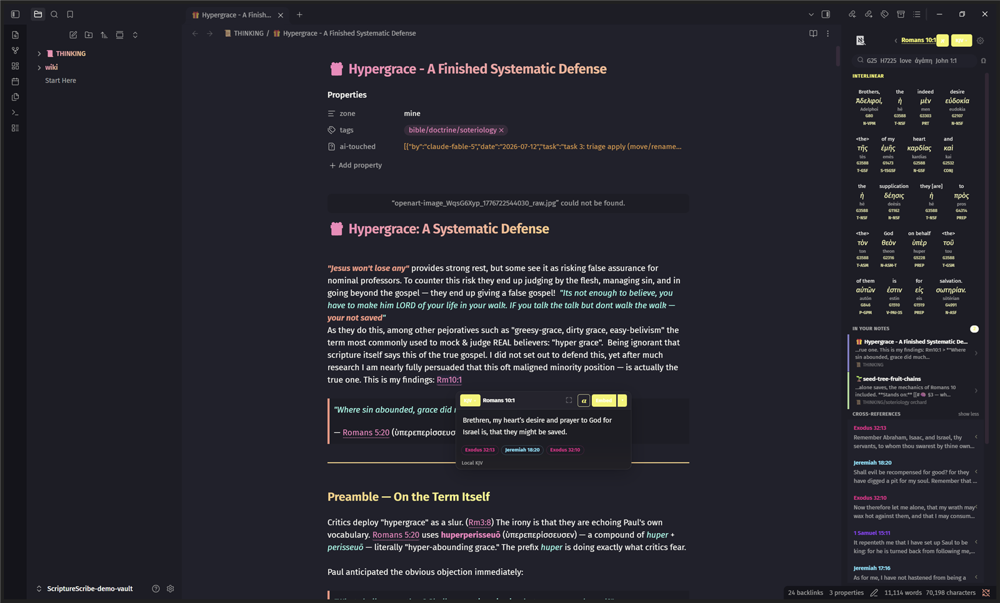
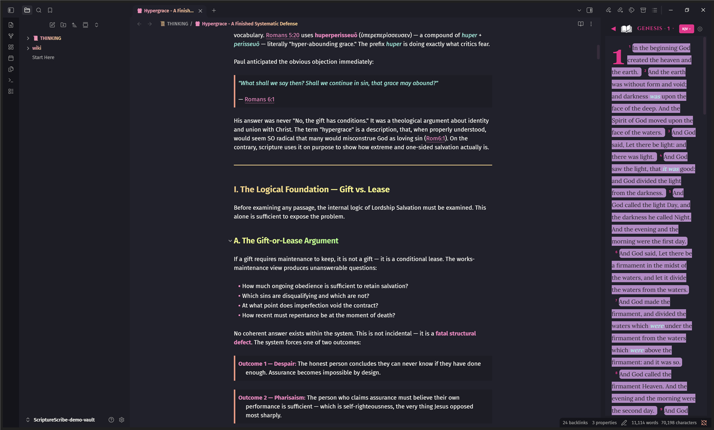
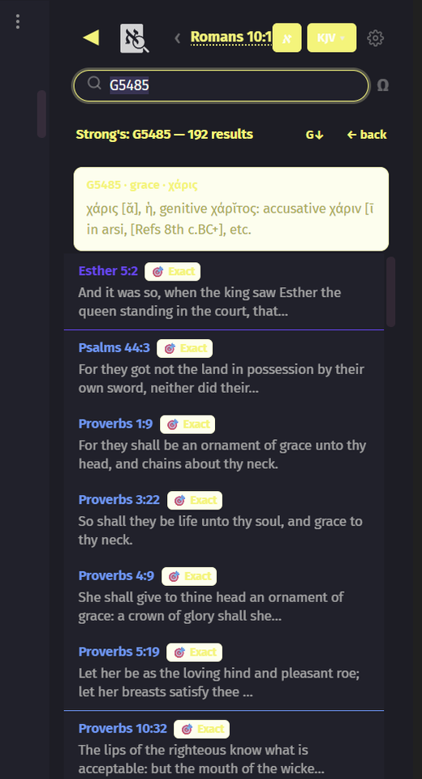

<div align="center">

# 📜 ScriptureScribe

**A Bible study workbench inside Obsidian.**
Hover any reference for the verse. Read Scripture in a side panel. Dig into Hebrew, Greek and the Septuagint. Turn verses into full-screen cards.

[**⬇ Download the plugin**](https://github.com/JoyRaptor/ScriptureScribe/releases/latest) · [Install in 2 minutes](#-install-in-2-minutes) · [Features](#-features)



</div>

---

## ✨ Features

### 💬 Hover any reference
Type `Rom 10:1`, `Gen 1:1-3`, `1 Cor 13:4` or `Jn 3:16` in any note and ScriptureScribe underlines it. Hover to see the verse, switch translation, jump to cross-references, or **embed** it as a link, footnote or quote block. Works offline: the KJV is bundled.

### 📖 Bible mode
A full reading panel in your sidebar. Browse any book and chapter, with verse numbers, drop caps, and the KJV's supplied words in *italics*, the way the translators printed them.



### 🔬 Research mode


- **Interlinear** Hebrew (OT), Greek (NT) and Septuagint, with transliteration, Strong's numbers and morphology on every word
- **Strong's search**: type `G5485` or `H7225` to get the lexicon entry and every verse that uses the word
- **Search by English, Greek, Hebrew or meaning**: keyword and semantic search across the whole Bible
- **Lexicons**: Strong's, LSJ (Liddell-Scott-Jones) and Swete's LXX
- **In your notes**: see every note in your vault that mentions the passage you are reading
- **Cross-references** under every verse

<br clear="right">

### 🖼 Card Mode
Turn any verse into a full-screen, cinematic card, ideal for sermon prep, recording, or presenting. Cards are plain HTML **skins** you can swap or write yourself. Included: *Velvet Aurora*, *Velvet Rainbow* and *Obsidian Minimal*.


### Everything else
- Multiple translations in the tooltip, falling back to the bundled KJV when offline
- Three embed styles: **link**, **footnote**, **quote block**, plus *Embed All* in one undo step
- 1 Enoch (Charles) supplement for the addresses the base text lacks
- Verse of the Day

---

## 🚀 Install in 2 minutes

> **No coding, no terminal.** The download already contains everything, including the Bible, Hebrew, Greek and lexicon data (about 77 MB zipped, 210 MB unzipped).

1. **[Download `scripture-scribe-v1.0.0.zip`](https://github.com/JoyRaptor/ScriptureScribe/releases/latest)** from the latest release.
2. **Unzip it.** You get one folder named `scripture-scribe`.
3. **Find your vault's plugins folder:** `<your vault>/.obsidian/plugins/`
   - `.obsidian` is hidden. In Obsidian go to **Settings → Files & Links** and note your vault location, then show hidden files:
     - **Windows:** File Explorer → View → Show → *Hidden items*
     - **Mac:** in Finder press `Cmd + Shift + .`
   - If there's no `plugins` folder, create one.
4. **Move the `scripture-scribe` folder into `plugins`.**
   The result should be `.obsidian/plugins/scripture-scribe/main.js`.
5. In Obsidian open **Settings → Community plugins**, turn off **Restricted mode**, click the refresh icon, and switch **ScriptureScribe** on.
6. Type a reference like `John 3:16` in a note and hover it. 🎉

**Opening the panels:** press `Ctrl/Cmd + P` and run **ScriptureScribe: Open Reading Panel** (Bible and Research modes), **Toggle Card Mode**, or **Search Strong's number**.

### Updating
Download the new zip and overwrite the `scripture-scribe` folder. Your settings are kept, because they live in `data.json`, which the zip never includes.

### Troubleshooting
| Problem | Fix |
|---|---|
| Plugin isn't listed | The folder must be exactly `.obsidian/plugins/scripture-scribe/` with `manifest.json` directly inside, not nested one level deeper. Click the refresh icon in Community plugins. |
| Nothing is underlined | Make sure the plugin is enabled and you are in a note, not a canvas. Try `John 3:16`. |
| First load is slow | The Greek, Hebrew and search data loads on demand, so the first lookup of each is the slowest. |

---

## 🧭 Commands

Open the command palette with `Ctrl/Cmd + P`:

| Command | What it does |
|---|---|
| **Open Reading Panel** | Bible mode / Research mode sidebar |
| **Toggle Card Mode** | Full-screen verse cards |
| **Search Strong's number** | Jump to a lexicon entry, e.g. `G5485` |
| **Show Verse of the Day** | Today's verse |
| **Embed All References as Links / Quote Blocks / Footnote Tooltips** | Convert every reference in the note, undo-able |

## 🔎 Recognised reference formats

`Genesis 1:1` · `Gen 1:1` · `Gn 1:1-3` · `1 Cor 13:4` · `2Tim 3:16` · `Jn 3:16` · `Ps 119:105` · `Rev 22`

## ✍️ Embedding styles

```md
[John 3:16](https://www.biblegateway.com/passage/?search=John+3%3A16&version=KJV)   ← link

John 3:16[^ss1]                                                                  ← footnote
[^ss1]: For God so loved the world... (KJV)

> "For God so loved the world, that he gave his only begotten Son..."             ← quote block
> — John 3:16, KJV
```

---

## 🛠 Build from source

```bash
git clone https://github.com/JoyRaptor/ScriptureScribe.git
cd ScriptureScribe
npm install
npm run build   # produces main.js
npm test
```

Copy `main.js`, `manifest.json`, `styles.css` and the data files into `<vault>/.obsidian/plugins/scripture-scribe/`. Most people should use the [release zip](https://github.com/JoyRaptor/ScriptureScribe/releases/latest) instead, since it bundles the data. See [DATA-SOURCES.md](DATA-SOURCES.md) for where each dataset comes from.

## 📚 Data & credits

KJV (public domain, with supplied-word markup from eBible), STEPBible TAHOT/TAGNT/TBESH/TBESG (CC BY 4.0, [STEPBible.org](https://www.stepbible.org)), LSJ, Swete's Septuagint, and R. H. Charles' 1 Enoch (1917). Full provenance in [DATA-SOURCES.md](DATA-SOURCES.md).

## License

MIT
